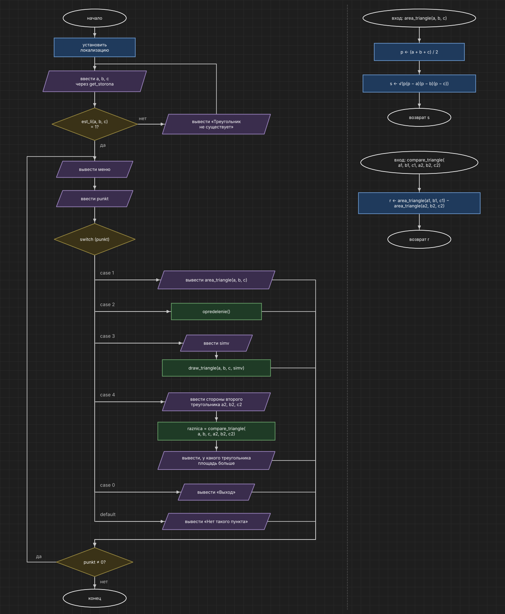

# Домашнее задание к работе 10

## Вариант 14

## Условие задачи

Составьте программу, которая для заданной пользователем фигуры предлагает меню выбора одной из операций:

1) рассчитать площадь;
2) вывести определение фигуры;
3) нарисовать фигуру.

Фигура: треугольник со сторонами a, b, c.

## 1. Алгоритм и блок-схема

### Алгоритм

1. Начало.
2. Установить локализацию.
3. Ввести стороны `a`, `b`, `c` функцией `get_storona`.
4. Пока `est_li(a, b, c) = 0` — вывести, что треугольник не существует, и ввести стороны заново.
5. Вывести меню и ввести `punkt`.
6. Выбор по значению `punkt`:
   - 1 → вывести площадь `area_triangle(a, b, c)`: `p = (a + b + c) / 2`, `s = √(p(p − a)(p − b)(p − c))`;
   - 2 → вызвать `opredelenie()`;
   - 3 → ввести `simv`, вызвать `draw_triangle(a, b, c, simv)`;
   - 4 → ввести стороны второго треугольника, `raznica = compare_triangle(a, b, c, a2, b2, c2)`, вывести, у какого треугольника площадь больше;
   - 0 → вывести «Выход»;
   - иначе → вывести «Нет такого пункта».
7. Если `punkt ≠ 0` — перейти к пункту 5.
8. Конец.

### Блок-схема



## 2. Реализация программы

```c
#define _CRT_SECURE_NO_WARNINGS
#include <stdio.h>
#include <stdlib.h>
#include <math.h>
#include <locale.h>

float area_triangle(float a, float b, float c);
void draw_triangle(int a, int b, int c, char simv);
void opredelenie(void);
int get_storona(char imya);
int est_li(int a, int b, int c);
float compare_triangle(int a1, int b1, int c1, int a2, int b2, int c2);

int main()
{
    int a, b, c;
    int a2, b2, c2;
    int punkt;
    char simv;
    float raznica;

    setlocale(LC_ALL, "Rus");

    printf("Введите стороны треугольника\n");
    a = get_storona('a');
    b = get_storona('b');
    c = get_storona('c');
    while (est_li(a, b, c) == 0)
    {
        printf("Треугольник с такими сторонами не существует, введите заново\n");
        a = get_storona('a');
        b = get_storona('b');
        c = get_storona('c');
    }

    do
    {
        printf("\nМеню:\n");
        printf("1 - рассчитать площадь\n");
        printf("2 - вывести определение фигуры\n");
        printf("3 - нарисовать фигуру\n");
        printf("4 - сравнить с другим треугольником по площади\n");
        printf("0 - выход\n");
        printf("Выберите пункт: ");
        punkt = 0;
        scanf("%d", &punkt);

        switch (punkt)
        {
        case 1:
            printf("Площадь треугольника со сторонами %d, %d, %d = %.2f\n", a, b, c, area_triangle(a, b, c));
            break;
        case 2:
            opredelenie();
            break;
        case 3:
            printf("Введите символ: ");
            scanf(" %c", &simv);
            draw_triangle(a, b, c, simv);
            break;
        case 4:
            printf("Введите стороны второго треугольника\n");
            a2 = get_storona('a');
            b2 = get_storona('b');
            c2 = get_storona('c');
            while (est_li(a2, b2, c2) == 0)
            {
                printf("Треугольник с такими сторонами не существует, введите заново\n");
                a2 = get_storona('a');
                b2 = get_storona('b');
                c2 = get_storona('c');
            }
            raznica = compare_triangle(a, b, c, a2, b2, c2);
            if (raznica > 0)
                printf("Площадь первого треугольника больше на %.2f\n", raznica);
            else if (raznica < 0)
                printf("Площадь второго треугольника больше на %.2f\n", -raznica);
            else
                printf("Площади треугольников равны\n");
            break;
        case 0:
            printf("Выход\n");
            break;
        default:
            printf("Нет такого пункта\n");
        }
    } while (punkt != 0);

    return 0;
}

float area_triangle(float a, float b, float c)
{
    float p, s;
    p = (a + b + c) / 2;
    s = sqrt(p * (p - a) * (p - b) * (p - c));
    return s;
}

void draw_triangle(int a, int b, int c, char simv)
{
    double x0, h, t, levo, pravo;
    int strok, i, j, sdvig, nachalo, konec;

    x0 = (c * c + a * a - b * b) / (2.0 * a);
    h = sqrt(c * c - x0 * x0);
    strok = (int)(h + 0.5);
    if (strok < 1)
        strok = 1;
    sdvig = 0;
    if (x0 < 0)
        sdvig = (int)floor(-x0 + 0.5);

    printf("\n");
    for (i = 0; i <= strok; i++)
    {
        t = (double)i / strok;
        levo = x0 * (1 - t);
        pravo = x0 + t * (a - x0);
        nachalo = (int)floor(levo + 0.5) + sdvig;
        konec = (int)floor(pravo + 0.5) + sdvig;
        if (konec <= nachalo)
            konec = nachalo + 1;

        for (j = 0; j < nachalo; j++)
            putchar(' ');
        for (j = nachalo; j < konec; j++)
            putchar(simv);
        printf("\n");
    }
}

void opredelenie(void)
{
    printf("Треугольник - это геометрическая фигура, образованная тремя отрезками,\n");
    printf("которые соединяют три точки, не лежащие на одной прямой.\n");
    printf("Треугольник со сторонами a, b, c существует, если a < b + c и a > |b - c|.\n");
}

int get_storona(char imya)
{
    int s = 0;
    int ch;
    while (s <= 0)
    {
        printf("Введите сторону %c: ", imya);
        if (scanf("%d", &s) != 1)
        {
            s = 0;
            while ((ch = getchar()) != '\n' && ch != EOF);
        }
        if (s <= 0)
            printf("Сторона должна быть целым числом больше 0\n");
    }
    return s;
}

int est_li(int a, int b, int c)
{
    if (a < b + c && a > abs(b - c))
        return 1;
    else
        return 0;
}

float compare_triangle(int a1, int b1, int c1, int a2, int b2, int c2)
{
    float r;
    r = area_triangle(a1, b1, c1) - area_triangle(a2, b2, c2);
    return r;
}
```

## 3. Результаты работы программы

```
Введите стороны треугольника
Введите сторону a: 3
Введите сторону b: 1
Введите сторону c: 1
Треугольник с такими сторонами не существует, введите заново
Введите сторону a: 10
Введите сторону b: 8
Введите сторону c: 6

Меню:
1 - рассчитать площадь
2 - вывести определение фигуры
3 - нарисовать фигуру
4 - сравнить с другим треугольником по площади
0 - выход
Выберите пункт: 1
Площадь треугольника со сторонами 10, 8, 6 = 24,00

Меню:
1 - рассчитать площадь
2 - вывести определение фигуры
3 - нарисовать фигуру
4 - сравнить с другим треугольником по площади
0 - выход
Выберите пункт: 2
Треугольник - это геометрическая фигура, образованная тремя отрезками,
которые соединяют три точки, не лежащие на одной прямой.
Треугольник со сторонами a, b, c существует, если a < b + c и a > |b - c|.

Меню:
1 - рассчитать площадь
2 - вывести определение фигуры
3 - нарисовать фигуру
4 - сравнить с другим треугольником по площади
0 - выход
Выберите пункт: 3
Введите символ: *

    *
   **
  ****
 ******
 ********
**********

Меню:
1 - рассчитать площадь
2 - вывести определение фигуры
3 - нарисовать фигуру
4 - сравнить с другим треугольником по площади
0 - выход
Выберите пункт: 4
Введите стороны второго треугольника
Введите сторону a: 5
Введите сторону b: 5
Введите сторону c: 5
Площадь первого треугольника больше на 13,17

Меню:
1 - рассчитать площадь
2 - вывести определение фигуры
3 - нарисовать фигуру
4 - сравнить с другим треугольником по площади
0 - выход
Выберите пункт: 4
Введите стороны второго треугольника
Введите сторону a: 3
Введите сторону b: 4
Введите сторону c: 5
Площадь первого треугольника больше на 18,00

Меню:
1 - рассчитать площадь
2 - вывести определение фигуры
3 - нарисовать фигуру
4 - сравнить с другим треугольником по площади
0 - выход
Выберите пункт: 9
Нет такого пункта

Меню:
1 - рассчитать площадь
2 - вывести определение фигуры
3 - нарисовать фигуру
4 - сравнить с другим треугольником по площади
0 - выход
Выберите пункт: 0
Выход
```

## 4. Информация о разработчике

Кочергин Савелий, группа бИД-261
